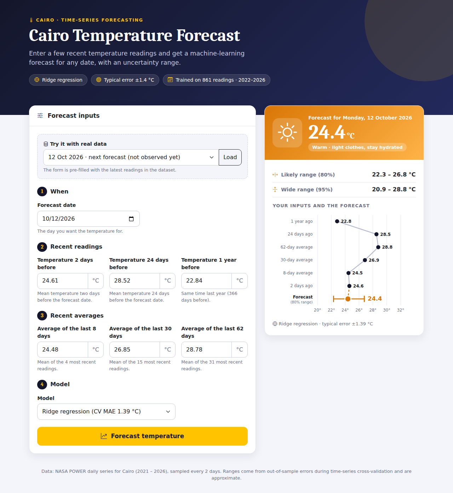
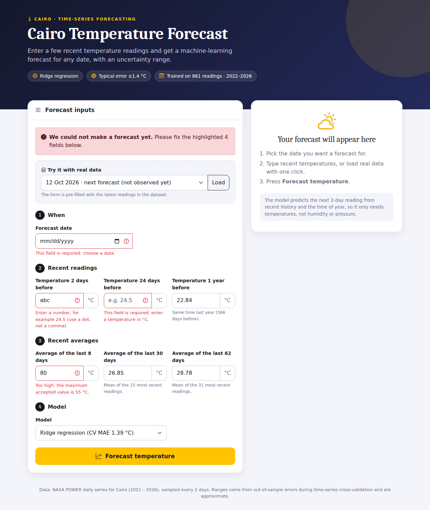
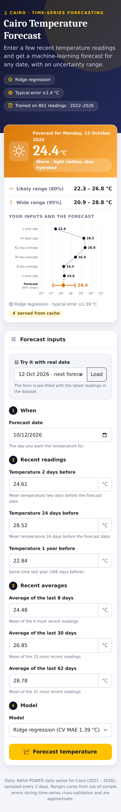
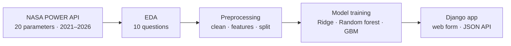

# 🌡️ Cairo Weather Forecast

An end-to-end machine-learning project on **Cairo's daily temperature**: data collected from a public weather API, a time-series exploratory analysis, a leakage-safe preprocessing pipeline, trained forecasting models, and a **Django web app** that serves them.

**🔗 Live Demo:** [https://weather-forecast-inky-phi.vercel.app](https://weather-forecast-inky-phi.vercel.app)

| Form + forecast | Input validation | On a phone |
|---|---|---|
|  |  |  |

---

## Pipeline



## Repository structure

```
Weather-Forecast-TimeSeries/
├── EDA/                       # 1. data collection + exploratory analysis
│   ├── dataset/               #    cairo_weather_2021_2026_2day.csv  (1,055 rows × 33 columns)
│   ├── notebook/              #    cairo_weather_eda.ipynb, cairo_weather_summary.md
│   └── presentation/          #    Cairo_Weather_EDA.pptx
├── Preprocessing/             # 2. cleaning, feature engineering, chronological split
│   ├── dataset/               #    cairo_weather_preprocessed_2day.csv, cairo_weather_model_ready_2day.csv
│   ├── notebook/              #    cairo_weather_preprocessing.ipynb
│   └── presentation/          #    Cairo_Preprocessing.pptx
└── Deployment/                # 3. models + Django web app (has its own detailed README)
```

---

## 1. Data and EDA

**Source:** [NASA POWER](https://power.larc.nasa.gov/) daily API (free, no paid key), queried at Cairo's coordinates (30.0444° N, 31.2357° E).
20 parameters (temperature, humidity, precipitation, wind, pressure, radiation) were requested one year at a time, giving 2,109 daily records from 2021-01-01 to 2026-10-10.
To stay within about 1,000–1,500 rows the series was sampled **every 2 days**, which gives **1,055 rows × 33 columns** (20 API parameters, 12 engineered features and the date).
The target is the mean air temperature at 2 m (`target_temperature_c`).

| Question | Finding |
|---|---|
| Is the series regular? | All 1,054 intervals are exactly 2 days, with no duplicates |
| Missing values | 36 values in each of 3 radiation columns, all at the end (Aug–Oct 2026); the target is complete |
| Distribution | Mean 22.5 °C, range 6.6–35.0 °C, **bimodal** (winter ≈ 15 °C, summer ≈ 30 °C). 74% of readings have no rain |
| Trend | Raw slope +0.49 °C/year is inflated (series starts in winter, ends in October). Full years 2021–2025: **+0.16 °C/year (p = 0.30)**; seasonally adjusted: +0.12 ± 0.09 |
| Seasonality | July is the hottest month (30.9 °C), January the coldest (13.3 °C): a 17.6 °C gap |
| Volatility | Spring is the most volatile season (rolling std 3.0 °C vs 1.7–1.9 °C elsewhere) |
| STL decomposition | **92%** of the variance is the seasonal cycle; trend ≈ 0.2%, residual ≈ 7% |
| ACF / PACF | Lag-1 autocorrelation 0.95; −0.82 at 6 months (opposite season) |
| Stationarity (ADF) | Rejects a unit root (p = 0.0011), but the mean still moves with the season |
| Correlations | Pressure −0.80, shortwave radiation +0.76, specific humidity +0.72, relative humidity −0.70, dew point +0.69; wind and rain ≈ ±0.14 |
| Anomalies | None flagged by a rolling z-score; 0 physically impossible values |

Open [`EDA/notebook/cairo_weather_eda.ipynb`](EDA/notebook/cairo_weather_eda.ipynb) for the code and plots, or [`EDA/presentation/Cairo_Weather_EDA.pptx`](EDA/presentation/Cairo_Weather_EDA.pptx) for the story.

---

## 2. Preprocessing

[`Preprocessing/notebook/cairo_weather_preprocessing.ipynb`](Preprocessing/notebook/cairo_weather_preprocessing.ipynb) turns the EDA table into a model-ready series.
The data is sampled every 2 days, so one "step" is 2 days (the annual cycle is 183 steps).

| Step | What was done |
|---|---|
| 1. Index | Sorted, duplicates dropped, re-indexed on the full 2D grid: **0 missing timestamps** |
| 2. Missing values | Time interpolation only for gaps of ≤ 2 steps *inside* the series; long target gaps would use the same date last year (183 steps); never forward-fill |
| 3. Validation | Physical limits (humidity 0–100 %, rain and wind ≥ 0): **0 violations** |
| 3. Outliers | Rolling median ± 4 robust σ (MAD) over a centred 31-step window; values are **capped, not deleted**: 6 of 1,055 changed, largest change 0.93 °C |
| 4. Features | 13 features: day-of-year sin/cos, day of week, is-weekend, lags 1 / 12 / 183, rolling mean and std over 4 / 15 / 31 steps. Rolling windows use `shift(1)` so a row never sees its own target |
| 5. Split | Chronological: train 2022-01-02 → 2026-09-18 (861 rows), hold-out = last 21 days (11 rows). MinMax scaler fitted on the training rows only |
| Output | `cairo_weather_model_ready_2day.csv` (872 rows × 14 columns). The 183-step annual lag removes the first 183 rows |

---

## 3. Models and web app

The [`Deployment/`](Deployment/) folder trains three models on the preprocessed features and serves them with Django (see [`Deployment/README.md`](Deployment/README.md) for the full guide).
The model predicts **the next 2-day reading** from the time of year and recent temperatures, using eight features: day-of-year sin/cos, lags 1 / 12 / 183 and rolling means over 4 / 15 / 31 steps.
Weekday, weekend and rolling-std features were dropped (no signal, and cross-validation improved without them).

| Model | CV MAE (°C) | Hold-out MAE (°C) |
|---|---|---|
| **Ridge regression** (default) | **1.39** | 0.76 |
| Random forest | 1.56 | 0.84 |
| Gradient boosting | 1.64 | 0.85 |
| *Baseline: same as 2 days ago* | 1.59 | 0.92 |
| *Baseline: same day last year* | 2.28 | 0.92 |

*CV* uses 5 expanding, time-ordered folds on the training rows and is the evidence to trust; the 11-row hold-out is small and optimistic.

**The app** provides a Bootstrap 5 form with grouped inputs and inline validation, a colour-coded forecast with 80 % and 95 % ranges, a chart of the inputs, a model dropdown, a JSON API (`/api/predict/`) and an in-memory cache.
Models load once at server start-up, and 28 automated tests prove that the app's features and predictions match the notebook.

### Quick start

```bash
git clone https://github.com/dyajaballh8/Weather-Forecast-TimeSeries.git
cd Weather-Forecast-TimeSeries/Deployment

python -m venv .venv
source .venv/bin/activate            # Windows PowerShell:  .venv\Scripts\Activate.ps1
pip install -r requirements.txt
python manage.py runserver           # open http://127.0.0.1:8000
```

The notebooks need Python 3.11+ with `pandas`, `numpy`, `matplotlib`, `seaborn`, `scipy`, `statsmodels`, `scikit-learn` and `jupyter`.
The downloaded dataset is included, so no API access is needed to run them.

---

## Limitations

- The hold-out contains only **11 readings from a single autumn stretch** (24.2–28.0 °C), so it is optimistic; cross-validation over many months is the reliable measure.
- Sampling every 2 days skips alternate days, so some rainy days are not in the dataset.
- NASA POWER is gridded, model-derived data, not a reading from one Cairo weather station.
- The forecast ranges are approximate: one global range from cross-validation errors, while spring errors are larger.
- The model forecasts one step ahead (the next 2-day reading) from temperatures you provide; it is not a multi-week forecaster.
- Less than six years of data is too short for climate-trend claims.

## Tech stack

Python · pandas · NumPy · SciPy · statsmodels · scikit-learn · Django · Bootstrap 5 · WhiteNoise · Vercel · Jupyter

## Author

[dyajaballh8](https://github.com/dyajaballh8) · Built during the ML internship program. Weather data: NASA POWER.
